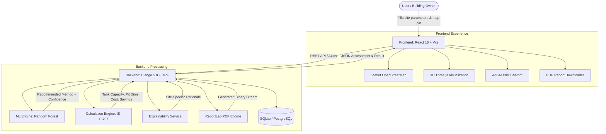

# 🌧️ AquaHarvest

> **AI-Assisted Rooftop Rainwater Harvesting & Artificial Recharge Assessment System**

[](LICENSE)
[](https://www.python.org/downloads/)
[](https://www.djangoproject.com/)
[](https://react.dev/)
[](https://vitejs.dev/)
[](https://tailwindcss.com/)
[](https://threejs.org/)

AquaHarvest is an end-to-end intelligent engineering assessment platform designed to tackle groundwater depletion and promote sustainable water conservation. It combines **Machine Learning recommendation algorithms** with **civil engineering formulas (IS 15797 standards)** to provide instant, on-spot assessments for Rooftop Rainwater Harvesting (RTRWH) and Artificial Recharge (AR) structures.

---

## 📑 Table of Contents

- [Key Features](#-key-features)
- [System Architecture](#-system-architecture)
- [Methodology & Engineering Formulas](#-methodology--engineering-formulas)
- [Supported Harvesting Methods](#-supported-harvesting-methods)
- [Project Structure](#-project-structure)
- [Tech Stack](#-tech-stack)
- [Getting Started](#-getting-started)
  - [Prerequisites](#prerequisites)
  - [Backend Setup](#1-backend-setup-django)
  - [Frontend Setup](#2-frontend-setup-react--vite)
  - [Dataset & Model Retraining (Optional)](#3-model-training-optional)
- [API Reference](#-api-reference)
- [AI Chatbot (AquaAssist)](#-ai-chatbot-aquaassist)
- [3D Interactive Simulation](#-3d-interactive-simulation)
- [Contributing](#-contributing)
- [License](#-license)

---

## ✨ Key Features

- **🤖 AI-Driven Method Recommendation**: Powered by a Scikit-Learn **Random Forest Classifier** trained on 5,000 synthetic ground-truth engineering records across 10 site parameters, delivering high-confidence decisions with explainable reasoning and engineering rule-based fallbacks.
- **📐 Standards-Compliant Engineering Calculations**: Deterministic sizing and capacity calculations based on **IS 15797 standards** — separate from ML predictions to guarantee precision and physical viability.
- **🗺️ Interactive Map & Geotagging**: Built-in Leaflet OpenStreetMap picker for pinpointing property location and capturing exact latitude and longitude coordinates.
- **🔮 Real-Time 3D System Visualization**: Interactive 3D scene built with Three.js and React Three Fiber featuring animated rainfall, conveyance pipe flow, storage reservoirs, filtration media, and aquifer percolation.
- **📄 Instant PDF Engineering Reports**: Automatic generation of comprehensive A4 engineering reports using ReportLab, complete with site specs, water balance equations, dimensional drawings, and cost estimations.
- **💬 AquaAssist Virtual Assistant**: Interactive in-app technical knowledge assistant explaining RWH concepts, hydrology parameters, sizing calculations, and local regulations.
- **📊 Assessment Dashboard & History**: Centralized log of all historical site assessments with full drill-down analysis, cost comparisons, and status indicators.

---

## 🏛️ System Architecture



---

## 📐 Methodology & Engineering Formulas

All numerical dimensions and economic values are calculated strictly using standard hydrological and civil engineering formulas.

### 1. Annual Rainwater Harvesting Potential

$$\text{Water Potential (L/year)} = \text{Roof Area } (m^2) \times \text{Annual Rainfall } (mm) \times \text{Runoff Coefficient} \times 1.0$$

#### Runoff Coefficients ($C$):
| Roof Material | Runoff Coefficient ($C$) | Description |
| :--- | :---: | :--- |
| **Metal Sheets** | `0.90` | Minimal absorption, highest water yield |
| **Concrete / RCC** | `0.85` | Standard urban rooftop with minor retention |
| **Asbestos Sheets** | `0.80` | Moderate surface friction and runoff |
| **Clay / Ceramic Tiles** | `0.75` | Increased percolation into porous joints |

---

### 2. Storage Tank Sizing (IS 15797 Demand Approach)

$$\text{Daily Household Demand (L/day)} = \text{Occupants} \times 135 \text{ L/person/day}$$

$$\text{Required Storage for 30 Dry Days (L)} = \text{Daily Demand} \times 30$$

$$\text{Tank Capacity } (m^3) = \max\left(1.0, \min\left(\frac{\text{Required Storage}}{1000}, \frac{0.25 \times \text{Water Potential}}{1000}\right)\right)$$

---

### 3. Artificial Recharge Pit Sizing

$$\text{Recharge Volume Needed } (m^3) = \frac{\text{Water Potential} \times 0.10}{1000}$$

$$\text{Pit Cross-Section Area } (m^2) = \frac{\text{Recharge Volume}}{\text{Pit Depth } (2.0\text{ m})}$$

$$\text{Length } (m) = \text{clamp}(2.0, 8.0, \sqrt{\text{Pit Area}})$$

$$\text{Width } (m) = \text{clamp}(2.0, 6.0, \frac{\text{Pit Area}}{\text{Length}})$$

---

### 4. Economic & Budget Estimation (INR)

- **RCC Storage Tank**: ₹4,500 / $m^3$
- **Recharge Pit**: ₹2,000 / $m^3$ of excavation and filter media
- **Recharge Well**: ₹45,000 fixed (casing + drilling + gravel pack)
- **Recharge Trench**: ₹800 / linear meter
- **Overhead / Piping & First Flush**: ₹5,000
- **Annual Monetary Savings**: Estimated at ₹5 per 1,000 Litres of municipal water conserved

---

## 💧 Supported Harvesting Methods

| Structure | Best Suited For | Infiltration / Storage Role |
| :--- | :--- | :--- |
| **Storage Tank** | High daily domestic demand, clayey/low-permeability soil, or restricted yard space. | Direct utilization for non-potable or treated potable water during dry periods. |
| **Recharge Pit** | Moderate to large open space, permeable soils (sandy, gravelly), shallow groundwater. | Artificial percolation into unconfined shallow aquifers. |
| **Recharge Well** | Deep groundwater table (>20–30 m), very limited open surface footprint. | Direct gravity injection into deeper aquifer layers through slotted casing pipes. |
| **Recharge Trench** | Sloped topography, linear boundary walls, clayey/loamy surface soils. | Progressive lateral percolation along perimeter runs. |
| **Storage Tank + Recharge Pit** | Large roof catchment (>400 $m^2$), heavy rainfall (>1000 mm), adequate budget. | Hybrid system: primary overflow diversion to storage, excess diverted to aquifer recharge. |

---

## 📁 Project Structure

```text
AquaHarvest/
│
├── backend/                        # Django REST Framework backend
│   ├── assessment/                 # Core assessment Django application
│   │   ├── migrations/             # Database migrations
│   │   ├── models.py               # Assessment & Result relational models
│   │   ├── serializers.py          # DRF serializers with nested relationships
│   │   ├── urls.py                 # REST endpoint routing
│   │   └── views.py                # Controller logic & API handlers
│   ├── config/                     # Django project configuration & settings
│   │   ├── asgi.py
│   │   ├── settings.py             # App configs, CORS, static root
│   │   ├── urls.py                 # Root URL configuration
│   │   └── wsgi.py
│   ├── ml/                         # Machine learning assets
│   │   ├── generate_dataset.py     # Generates 5,000 synthetic hydrology records
│   │   ├── train_model.py          # Random Forest training script
│   │   └── model.pkl               # Serialized scikit-learn model artifact
│   ├── services/                   # Business & hydraulic logic services
│   │   ├── calculation_engine.py   # Civil engineering & hydrology calculations
│   │   ├── pdf_service.py          # ReportLab PDF generation engine
│   │   └── recommendation_service.py # ML inference & rule-based fallback
│   ├── manage.py                   # Django CLI utility
│   └── requirements.txt            # Python dependencies
│
├── frontend/                       # Vite + React frontend application
│   ├── public/                     # Static assets and icons
│   ├── src/
│   │   ├── components/             # Reusable UI & 3D components
│   │   │   ├── Chatbot.jsx         # AquaAssist virtual assistant component
│   │   │   ├── Navbar.jsx          # Header navigation bar
│   │   │   └── ThreeDViewer.jsx    # React Three Fiber 3D flow visualizer
│   │   ├── pages/                  # Application views & pages
│   │   │   ├── About.jsx           # Technical specifications & overview
│   │   │   ├── Assessment.jsx      # Multi-step assessment input form with Leaflet map
│   │   │   ├── Dashboard.jsx       # Real-time analytics, map overview & recent tests
│   │   │   ├── History.jsx         # Historical audit table of assessments
│   │   │   └── Results.jsx         # Assessment report, 3D model & PDF generator
│   │   ├── services/
│   │   │   └── api.js              # Axios HTTP client configuration & API calls
│   │   ├── App.jsx                 # Route definition & layout
│   │   ├── main.jsx                # React DOM entry point
│   │   └── styles.css              # Custom Tailwind directives & theme styles
│   ├── index.html                  # HTML entry point
│   ├── package.json                # Node dependencies & npm scripts
│   ├── postcss.config.js           # PostCSS configuration
│   ├── tailwind.config.js          # Tailwind styling tokens & theme
│   └── vite.config.js              # Vite server & build configuration
│
├── datasets/                       # Hydrology & assessment training data
│   └── recommendation_dataset.csv  # 5,000 synthetic site records
│
├── docs/                           # Documentation and guides
└── README.md                       # Main project documentation
```

---

## 🛠️ Tech Stack

### Frontend
- **Framework**: [React 18](https://react.dev/) with [Vite](https://vitejs.dev/)
- **Styling**: [Tailwind CSS 3](https://tailwindcss.com/) with custom dark/neon-hydrology theme
- **Animations**: [Framer Motion](https://www.framer.com/motion/)
- **3D Graphics**: [Three.js](https://threejs.org/), [@react-three/fiber](https://r3f.docs.pmnd.rs/), [@react-three/drei](https://github.com/pmndrs/drei)
- **GIS / Mapping**: [Leaflet](https://leafletjs.com/) and [React Leaflet](https://react-leaflet.js.org/)
- **HTTP Client**: [Axios](https://axios-http.com/)
- **Icons & Routing**: [React Router v6](https://reactrouter.com/)

### Backend
- **Framework**: [Python 3.10+](https://www.python.org/) & [Django 5.0](https://www.djangoproject.com/)
- **API**: [Django REST Framework (DRF)](https://www.django-rest-framework.org/)
- **Document Generation**: [ReportLab](https://www.reportlab.com/) (Vector PDF generation)
- **CORS Handling**: `django-cors-headers`
- **Database**: SQLite (built-in default) / PostgreSQL compliant

### Machine Learning & Data Science
- **Libraries**: `scikit-learn 1.4+`, `pandas 2.2+`, `numpy 1.26+`, `joblib`
- **Algorithm**: Random Forest Classifier with One-Hot feature encoding and probability estimation
- **Validation**: Fallback to rule-based engineering heuristics if model confidence or input deviations occur

---

## 🚀 Getting Started

### Prerequisites

Make sure you have the following installed on your system:
- **Python**: Version `3.10` or higher
- **Node.js**: Version `18.0.0` or higher
- **npm**: Version `9.0.0` or higher
- **Git**

---

### 1. Backend Setup (Django)

1. Open your terminal and navigate to the backend directory:
   ```bash
   cd backend
   ```

2. (Recommended) Create and activate a virtual environment:
   - **Windows**:
     ```powershell
     python -m venv venv
     .\venv\Scripts\activate
     ```
   - **macOS / Linux**:
     ```bash
     python3 -m venv venv
     source venv/bin/activate
     ```

3. Install required Python packages:
   ```bash
   pip install -r requirements.txt
   ```

4. Apply database migrations:
   ```bash
   python manage.py migrate
   ```

5. Start the Django development server:
   ```bash
   python manage.py runserver
   ```
   The backend API will be available at: **`http://127.0.0.1:8000/`**

---

### 2. Frontend Setup (React + Vite)

1. Open a new terminal and navigate to the frontend directory:
   ```bash
   cd frontend
   ```

2. Install npm dependencies:
   ```bash
   npm install
   ```

3. Start the Vite development server:
   ```bash
   npm run dev
   ```
   The frontend application will be available at: **`http://localhost:5173/`**

---

### 3. Model Training (Optional)

The pre-trained model artifact (`backend/ml/model.pkl`) is included with the project. If you wish to regenerate the dataset or retrain the classifier:

1. **Regenerate Synthetic Dataset**:
   ```bash
   cd backend
   python ml/generate_dataset.py
   ```
2. **Retrain Random Forest Classifier**:
   ```bash
   python ml/train_model.py
   ```

---

## 🔌 API Reference

### 1. Create Full Assessment & Run Sizing
- **Endpoint**: `POST /api/assessment/complete/`
- **Description**: Stores property details, executes ML prediction, runs hydraulic calculations, and saves the final result.
- **Request Body (JSON)**:
  ```json
  {
    "owner_name": "John Doe",
    "building_name": "Eco Haven",
    "address": "42 Green Valley Road",
    "district": "Bangalore Urban",
    "property_type": "Residential",
    "roof_length": 15.0,
    "roof_width": 10.0,
    "roof_material": "Concrete",
    "roof_type": "Flat",
    "rainfall": 950.0,
    "soil_type": "Sandy",
    "groundwater_level": 12.0,
    "open_space": 25.0,
    "occupants": 4,
    "budget": 100000,
    "latitude": 12.9716,
    "longitude": 77.5946
  }
  ```
- **Response (200 OK)**:
  ```json
  {
    "id": 1,
    "recommended_method": "Recharge Pit",
    "confidence_score": 0.94,
    "recommendation_reason": "Your site has 25 m² of available open space and Sandy soil...",
    "water_potential": 121125.0,
    "tank_capacity": 16.2,
    "pit_length": 2.46,
    "pit_width": 2.46,
    "pit_depth": 2.0,
    "estimated_cost": 24200.0,
    "within_budget": true,
    "roof_area": 150.0,
    "runoff_coefficient": 0.85,
    "daily_demand_litres": 540,
    "annual_savings_inr": 6056.0
  }
  ```

---

### 2. Predict Method (Dry Run / No Save)
- **Endpoint**: `POST /api/predict/`
- **Description**: Evaluates method and dimensions on-the-fly without database persistence.

---

### 3. List All Assessments
- **Endpoint**: `GET /api/assessment/`
- **Description**: Returns all historical assessments with nested results sorted in descending order of creation.

---

### 4. Fetch Single Assessment
- **Endpoint**: `GET /api/assessment/<id>/`
- **Description**: Retrieves full input parameters and calculation outputs for a specific ID.

---

### 5. Download Assessment PDF Report
- **Endpoint**: `GET /api/report/<id>/pdf/`
- **Description**: Streams a formatted A4 PDF engineering document directly to the client browser.

---

## 💬 AI Chatbot (AquaAssist)

Located in the bottom corner of every page, **AquaAssist** is an intelligent interactive assistant trained on hydrology and rainwater harvesting knowledge:
- Answers queries regarding tank sizing algorithms and runoff coefficients.
- Clarifies soil types and groundwater table relationships.
- Explains why a particular structure was chosen.
- Ready for plug-and-play integration with Google Gemini or OpenAI APIs via backend webhook endpoints.

---

## 🔮 3D Interactive Simulation

On the assessment results screen, AquaHarvest displays an interactive Three.js viewport:
- **Dynamic Particles**: Real-time falling rain particles with surface contact detection.
- **Catchment & Piping**: Animated flow through collection pipes and first-flush filters.
- **Structure Demonstration**: 3D geometric representations for Storage Tanks, Recharge Pits, Recharge Wells, and Trenches.
- **Percolation Effect**: Visual aquifer seepage illustrating artificial groundwater recharge.
- **Controls**: Full OrbitControls (pan, zoom, rotate) for 360-degree inspection.

---

## 🤝 Contributing

Contributions are warmly welcomed! To contribute:

1. Fork the repository.
2. Create your feature branch (`git checkout -b feature/HydrologyEnhancement`).
3. Commit your changes (`git commit -m "Add solar-powered pump calculation support"`).
4. Push to the branch (`git push origin feature/HydrologyEnhancement`).
5. Open a Pull Request.

---

## 📄 License

This project is licensed under the **MIT License**. See the [LICENSE](LICENSE) file for more details.
